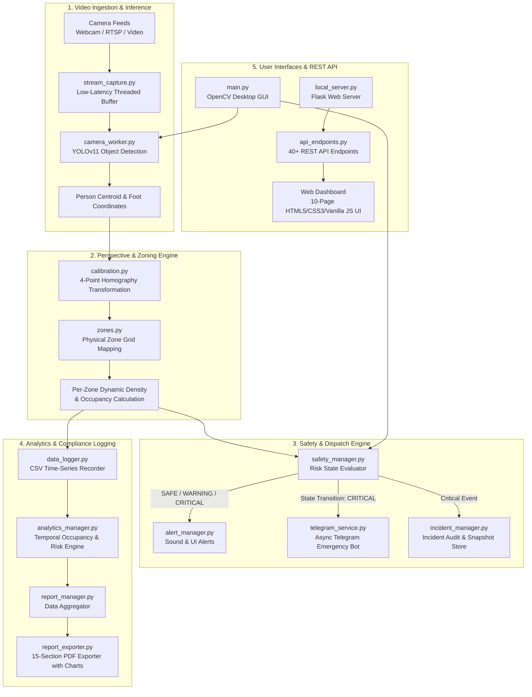

# CrowdSense — Real-Time Computer Vision Crowd Safety & Monitoring System

[](https://www.python.org/)
[](https://flask.palletsprojects.com/)
[](https://github.com/ultralytics/ultralytics)
[](https://opencv.org/)
[](LICENSE)

CrowdSense is an end-to-end, edge-deployable computer vision platform engineered to monitor real-time crowd dynamics, estimate spatial density, track per-zone occupancy, and trigger automated emergency mitigation procedures to prevent overcrowding and stampede risks at physical venues.

---

## Table of Contents

- [Problem Statement](#problem-statement)
- [System Architecture](#system-architecture)
- [Technical Design Documentation](#technical-design-documentation)
- [Core Features](#core-features)
- [Technology Stack](#technology-stack)
- [Project Directory Structure](#project-directory-structure)
- [Prerequisites](#prerequisites)
- [Installation & Setup](#installation--setup)
- [Configuration (.env)](#configuration-env)
- [Sample Data & Benchmarks](#sample-data--benchmarks)
- [Usage Instructions](#usage-instructions)
  - [1. Launching the OpenCV Desktop Interface](#1-launching-the-opencv-desktop-interface)
  - [2. Launching the Web Management Dashboard](#2-launching-the-web-management-dashboard)
- [REST API Endpoints](#rest-api-endpoints)
- [Verification & Automated Testing](#verification--automated-testing)
- [Publishing & Repository Information](#publishing--repository-information)
- [License](#license)

---

## Problem Statement

Large public gatherings, festivals, transport terminals, and stadiums present severe safety challenges. Overcrowding frequently causes fatal stampedes, compressive asphyxia, and localized bottleneck surges before venue supervisors become aware of critical density thresholds. 

Traditional physical security depends largely on human observation or delayed manual headcounts that lack objective spatial measurement. **CrowdSense** solves this by converting commodity CCTV and IP/RTSP camera feeds into real-time, metric-calibrated spatial intelligence. By combining YOLO person detection with perspective-corrected floor mapping and configurable per-zone safety thresholds, the system provides automated multi-channel emergency alerting before densities reach hazardous levels.

---

## System Architecture



---

## Technical Design Documentation

A comprehensive engineering specification detailing system mathematics, homography projection formulas, state-transition deduplication algorithms, and deployment topology is available in:

👉 **[docs/TECHNICAL_DESIGN.md](docs/TECHNICAL_DESIGN.md)**

---

## Core Features

- **YOLOv11 Person Detection**: Utilizes state-of-the-art `ultralytics` YOLO models running on CPU/GPU, extracting bottom-center grounding coordinates of individuals for spatial tracking.
- **4-Point Perspective Calibration**: Maps arbitrary angled camera perspectives to top-down 2D real-world metric coordinates using planar homography matrix transformation.
- **Smart Physical Zoning**: Dynamically subdivides rectangular and circular venues into configurable spatial grid zones, computing per-zone square meter areas, capacities, and real-time densities (`people/m²`).
- **Granular Per-Zone Safety Thresholds**: Supports custom warning and critical occupancy limits per zone (e.g., lower capacity thresholds for narrow choke points/exits vs. open plazas) with venue default inheritance.
- **Automated Emergency Telegram Alerts**: Multi-threaded, asynchronous background notification daemon delivering instant Markdown alerts with cooldown rate-limiting and state-deduplication to venue safety managers.
- **Incident Snapshots & Black-Box Auditing**: Captures high-resolution frame snapshots and logs structured incident histories whenever a zone breaches critical density thresholds.
- **Comprehensive 15-Section PDF Safety Reports**: Generates formal event safety audit reports using `ReportLab` and `Matplotlib` charts covering peak occupancy, risk timelines, per-zone compliance metrics, and incident summaries.
- **Dual Operating Interfaces**:
  1. **OpenCV Desktop GUI**: Standalone terminal/desktop display rendering live bounding boxes, status HUDs, zone matrices, and calibration overlays.
  2. **10-Page Web Management Console**: Responsive HTML5/JS dashboard featuring real-time telemetry, interactive floorplan editors, multi-camera matrix, logs, session timer, and alert dispatch centers.
- **RESTful API Architecture**: Over 40 documented Flask endpoints serving live video frames (`multipart/x-mixed-replace`), zone telemetry, camera configurations, and analytics.

---

## Technology Stack

| Domain | Technology / Library | Purpose |
| :--- | :--- | :--- |
| **Language** | Python 3.10+ | Core platform implementation |
| **Computer Vision** | `ultralytics` (YOLOv11), `opencv-python` (5.0.0.93) | Real-time object detection, frame capture, homography calibration |
| **Deep Learning** | `torch` (2.14.0), `torchvision` (0.29.0) | Neural network inference backend (CUDA or CPU) |
| **Web Server & API** | `Flask` (3.1.3), `Werkzeug` (3.1.8) | RESTful API backend, server-sent MJPEG streaming |
| **Document Generation** | `reportlab` (5.0.1) | PDF safety audit and compliance report creation |
| **Data Analytics** | `numpy` (2.2.6), `matplotlib` (3.10.9), `polars` (1.44.2) | Vector transformations, statistical modeling, chart rendering |
| **Notifications** | `requests` (2.34.2) | Asynchronous Telegram Bot API dispatching |
| **Frontend UI** | HTML5, Vanilla JavaScript, CSS3 | Zero-dependency, low-latency operator dashboard |

---

## Project Directory Structure

```text
crowdsense/
├── app/
│   ├── main.py                     # Primary desktop entry point (OpenCV UI)
│   ├── local_server.py             # Flask Web Server entry point
│   ├── api_endpoints.py            # Complete REST API blueprint (40+ endpoints)
│   ├── camera_worker.py            # Multi-threaded YOLO inference engine
│   ├── stream_capture.py           # Non-blocking threaded video stream reader
│   ├── calibration.py              # 4-point homography & metric coordinate mapper
│   ├── zones.py                    # Spatial grid generation & zone threshold engine
│   ├── safety_manager.py           # Real-time risk evaluation (SAFE/WARNING/CRITICAL)
│   ├── telegram_service.py         # Asynchronous emergency Telegram alert worker
│   ├── alert_manager.py            # Local alert state controller & sound dispatcher
│   ├── incident_manager.py         # Incident logger & frame snapshot repository
│   ├── analytics_manager.py        # Occupancy time-series & zone statistics engine
│   ├── report_manager.py           # Report data aggregator & metric synthesizer
│   ├── report_exporter.py          # 15-Section PDF document generator
│   ├── session_manager.py          # Monitoring session lifecycle controller
│   ├── data_logger.py              # CSV crowd telemetry logging
│   ├── camera_manager.py           # Multi-source camera feed controller
│   ├── venue.py                    # Physical venue dimension & geometry model
│   ├── static/                     # Web dashboard assets & stylesheets
│   └── *.html                      # 10 Web dashboard views (admin, analytics, etc.)
├── docs/
│   └── TECHNICAL_DESIGN.md         # In-depth system design & mathematical specs
├── sample_data/
│   ├── README.md                   # Safe data guide & benchmark acquisition info
│   ├── sample_venue_config.json    # Example venue configuration with custom thresholds
│   ├── sample_camera_calibration.json # Example 4-point perspective matrix
│   └── sample_crowd_log.csv        # Synthetic time-series crowd telemetry
├── tests/
│   ├── __init__.py                 # Test package runner
│   ├── run_all_tests.py            # Master automated test runner (61 tests)
│   ├── test_crowd_density.py       # 10 Unit tests for crowd counting & density
│   ├── test_zone_thresholds.py     # 12 Integration tests for zoning, API & PDF
│   └── test_telegram_service.py    # 39 Unit/Security tests for Telegram alerting
├── data/                           # Runtime logs, reports, snapshots (gitignored)
├── .env.example                    # Template environment variables
├── .gitignore                      # Git exclusion rules
├── LICENSE                         # MIT License
├── requirements.txt                # Pinned production dependencies
└── README.md                       # Comprehensive documentation
```

---

## Prerequisites

1. **Python 3.10 or higher** installed on Windows, macOS, or Linux.
2. **YOLOv11 Weights File**: Download `yolo11n.pt` (or any compatible Ultralytics YOLO model) into the project root directory.
3. **Telegram Account (Optional)**: If emergency notifications are desired, create a bot via [@BotFather](https://t.me/BotFather) and retrieve your Chat ID via [@userinfobot](https://t.me/userinfobot).
4. **Video Source**: Integrated webcam, USB camera, RTSP IP stream, or local video file (`.mp4`, `.avi`).

---

## Installation & Setup

### 1. Clone the Repository
```bash
git clone https://github.com/Deveshsharma5/crowdsense_monitoring_system.git
cd crowdsense_monitoring_system
```

### 2. Configure Virtual Environment
- **Windows (Command Prompt / PowerShell)**:
  ```powershell
  python -m venv venv
  venv\Scripts\activate
  ```
- **macOS / Linux**:
  ```bash
  python3 -m venv venv
  source venv/bin/activate
  ```

### 3. Install Required Dependencies
```bash
pip install --upgrade pip
pip install -r requirements.txt
```

### 4. Download YOLOv11 Model
Download `yolo11n.pt` directly via Python:
```bash
python -c "from ultralytics import YOLO; YOLO('yolo11n.pt')"
```

---

## Configuration (.env)

Duplicate `.env.example` to create your private `.env` file:
```bash
cp .env.example .env
```

Open `.env` in an editor and specify your Telegram parameters:
```ini
# ===================================================
# CrowdSense Environment Configuration
# ===================================================

# Telegram Emergency Alerts Bot
# Obtain your bot token from @BotFather on Telegram
TELEGRAM_BOT_TOKEN=your_bot_token_here

# Your Telegram numeric Chat ID
# Obtain via @userinfobot on Telegram
TELEGRAM_CHAT_ID=your_chat_id_here

# Minimum cooldown period (in seconds) between alerts for the same zone
TELEGRAM_COOLDOWN_SECONDS=300
```

> **Note**: If `TELEGRAM_BOT_TOKEN` is left unconfigured, CrowdSense operates normally in simulation mode without raising exceptions.

---

## Sample Data & Benchmarks

For offline evaluation without a live camera setup, pre-configured sample datasets and guides are available in the [sample_data/](sample_data/) directory:
- `sample_data/sample_venue_config.json`: Ready-to-use 30m × 15m exhibition hall configuration.
- `sample_data/sample_camera_calibration.json`: Pre-computed 4-point homography calibration.
- `sample_data/sample_crowd_log.csv`: Synthetic multi-zone crowd telemetry across SAFE, WARNING, and CRITICAL states.
- `sample_data/README.md`: Instructions on loading sample data and acquiring public research benchmark video sets (PETS 2009, Town Centre).

---

## Usage Instructions

### 1. Launching the OpenCV Desktop Interface
To start the live desktop visualization with integrated camera display:
```bash
python app/main.py
```
- **Live HUD**: Displays real-time people count, current risk level, and zone coordinates.
- **Controls**:
  - `q`: Exit desktop view.
  - `c`: Open interactive 4-point calibration window.
  - `z`: Toggle zone overlay display.

### 2. Launching the Web Management Dashboard
To start the full web platform:
```bash
python app/local_server.py
```
Navigate to **`http://localhost:5000`** in any web browser.

The web suite includes 10 dedicated management interfaces:
- `/dashboard`: Real-time camera streaming with live overlay, active zone cards, risk indicators, and quick-dispatch buttons.
- `/venue`: Define rectangular or circular venue dimensions, capacities, and base thresholds.
- `/zones`: Configure individual zone occupancy thresholds, view zone capacities, and reset to venue defaults.
- `/calibration`: Interactive canvas to click four corner points on the camera feed for perspective correction.
- `/cameras`: Add, configure, and switch between multi-camera RTSP/USB inputs.
- `/alerts`: Audit log of all SAFE, WARNING, and CRITICAL state transitions.
- `/incidents`: Review captured critical incident logs and visual snapshots.
- `/analytics`: Historical crowd density trends, peak occupancy charts, and zone breakdown graphs.
- `/reports`: Generate and download formal 15-section PDF event safety reports.
- `/session`: Live session timer, active duration tracking, and session dispatch history.

---

## REST API Endpoints

CrowdSense exposes a REST API consumed by the web client and external security systems:

| Endpoint | Method | Description |
| :--- | :---: | :--- |
| `/video_feed` | `GET` | Live MJPEG stream with detection and zone overlays |
| `/api/system/status` | `GET` | Global system status, active risk, total crowd count |
| `/api/venue` | `GET`, `POST` | Retrieve or update venue dimensions, shape, and capacities |
| `/api/zones` | `GET` | Get real-time metrics for all generated physical zones |
| `/api/zones/<id>/thresholds` | `GET` | Get configured warning and critical limits for a specific zone |
| `/api/zones/<id>/thresholds` | `POST` | Set custom warning/critical occupancy thresholds for a zone |
| `/api/calibration` | `GET`, `POST` | Fetch or submit 4-point perspective calibration matrix |
| `/api/alerts` | `GET` | Query recent warning and critical safety alert logs |
| `/api/incidents` | `GET` | Retrieve recorded critical incidents with snapshot URLs |
| `/api/telegram/status` | `GET` | Check Telegram bot configuration and worker thread state |
| `/api/telegram/test` | `POST` | Trigger an immediate test message to the configured Telegram chat |
| `/api/analytics` | `GET` | Fetch computed statistical metrics (averages, peaks, zone distribution) |
| `/api/reports/generate` | `POST` | Compile and export an official 15-section PDF safety report |

---

## Verification & Automated Testing

The repository includes a comprehensive automated test suite covering all critical safety, risk calculation, Telegram alert dispatch, and PDF generation subsystems.

### Running All Tests
Execute the unified master test runner:
```bash
python tests/run_all_tests.py
```

### Running Individual Test Suites
1. **Crowd Counting & Spatial Density Unit Tests**:
   ```bash
   python tests/test_crowd_density.py
   ```
   *Covers:* Grid generation, coordinate resolution to zones, single/multi-person counting, density ($\text{people}/m^2$) calculation, area capacities, occupancy percentages, boundary clamping, circular venue geometry, and threshold transitions. *(10/10 Tests Passing)*

2. **Zone Thresholds & PDF Integration Tests**:
   ```bash
   python tests/test_zone_thresholds.py
   ```
   *Covers:* VenueConfig initialization, PhysicalZoneManager grid creation, validation of threshold ranges (`warning < critical`), custom threshold application, zone risk state calculation, API threshold endpoints, AnalyticsManager integration, and 15-section PDF report generation. *(12/12 Tests Passing)*

3. **Telegram Alerting & Security Unit Tests**:
   ```bash
   python tests/test_telegram_service.py
   ```
   *Covers:* Thread safety, token obfuscation/redaction, state transition deduplication, cooldown rate-limiting, message body formatting, queue overflow protection, and Flask API integration. *(39/39 Tests Passing)*

---

## Publishing & Repository Information

- **Official Repository**: [https://github.com/Deveshsharma5/crowdsense_monitoring_system](https://github.com/Deveshsharma5/crowdsense_monitoring_system)
- **Primary Branch**: `main`
- **License**: MIT License

---

## License

This project is licensed under the MIT License — see the [LICENSE](LICENSE) file for details.
